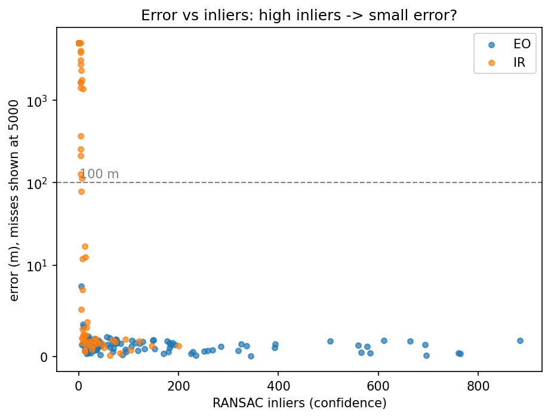
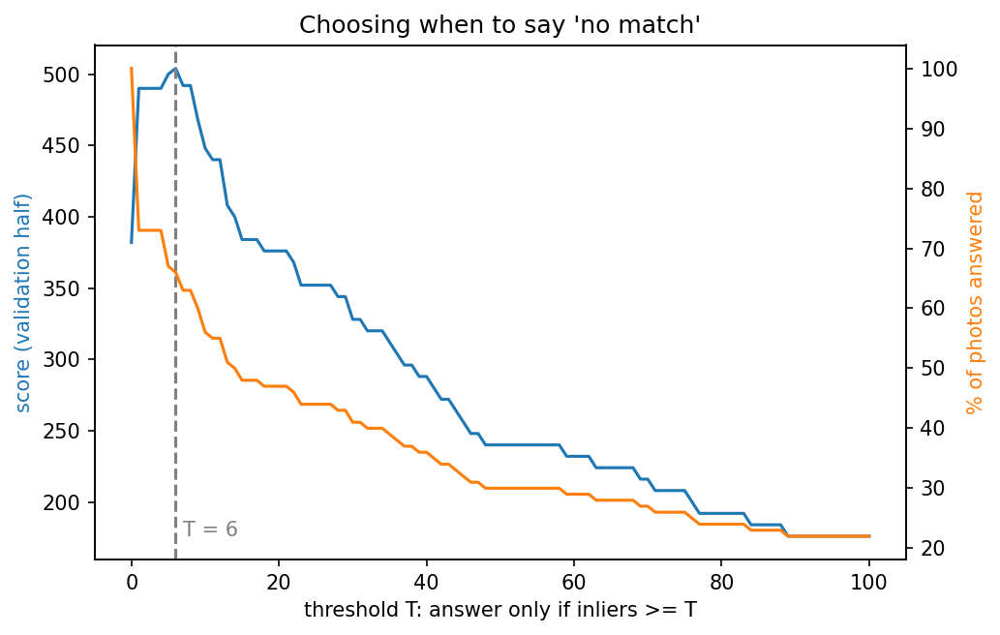

# GeoLoc-Eval: locating drone-style photos on a satellite map, and knowing when not to answer

A small, honest version of the UAV visual geo-localisation problem: given a downward-looking photo, find the latitude/longitude of its centre on a satellite map, and say **"no match"** when the system isn't confident enough. Every test photo has a known true location, so every guess can be scored in metres.

Built in Python with OpenCV, pyproj, contextily, NumPy, pandas and matplotlib (Google Colab).

## Results at a glance

| | Result |
|---|---|
| Colour (EO) photos, located within 100 m | **93%** (median error ~1 m) |
| Thermal-like (IR) photos, located within 100 m | **39%** overall: 71% / 34% / 9% for light / medium / heavy brightness flip |
| High-altitude vs low-altitude photos, within 100 m | 44% vs 85% |
| No-match rule (answer only if RANSAC inliers ≥ 6) | held-out score **438 → 524 (+20%)**, answering 66% of photos |
| Speed | ~2 s per photo for a brute-force search over 49 tiles (Colab CPU) |

## Pipeline

1. **Georeferenced map.** A ~4 × 4 km Esri World Imagery map around IIT Gandhinagar (zoom 16, ~2.2 m/pixel), downloaded with `contextily` together with its Web Mercator extent. `pixel_to_latlon` / `latlon_to_pixel` convert between image pixels and lat/lon via `pyproj` (EPSG:3857 ↔ EPSG:4326). Round-trip error: ~1e-9 m.
2. **Tiling.** 512 px tiles with 50% overlap (49 tiles), each with its pixel and lat/lon bounds; SIFT features precomputed once per tile.
3. **Synthetic queries with ground truth.** 200 patches cut at random map locations, then rotated (heading), rescaled 0.5–1.8× (altitude), re-lit, blurred, and for half of them made "thermal-like": greyscale, noise, blur, and a random fraction of the scene's brightness inverted, mimicking materials that swap bright/dark in infrared.
4. **Localiser.** SIFT keypoints → brute-force matching with Lowe's ratio test → RANSAC homography against every tile → the tile with most inliers wins → the photo's centre is projected through the homography → map pixel → lat/lon. The inlier count is kept as the confidence.
5. **Evaluation harness.** Haversine error in metres; the PS's example scoring (+8 < 100 m, +4 < 250 m, +2 < 500 m, −4 otherwise, 0 for "no match"); a results table per condition (EO/IR, altitude band, flip strength).
6. **No-match rule.** Sweep the threshold T ("answer only if inliers ≥ T") on a random validation half, pick the best T, and report its score on the untouched held-out half.

## Findings

- **Inliers work as a yes/no confidence, not a precision dial.** If you look at the correct matches, you can clearly see that their inlier count is not really a factor. However for wrong matches, they are always off by a large distance and almost always have less than 10 inliers. Hence they basically act as a yes or no confidence.
- **Infrared is the main failure mode.** SIFT descriptors use brightness gradients, so when we inverted brightness, it destroyed matches. Fully inverted photos got 0 inliers in every case, and if you look at the accuracy versus the inverting brightness, it fell more as more of the scene was flipped. 
- **Altitude matters.** Results showed that the images with higher altitude gave fewer keypoints and failed more often.
- **The threshold is robust.** Score is nearly flat for T between 2 and 8, so the exact choice is not a knife-edge, it is clearly robust.
- **Brute-force search is too slow at scale.** 2 s per photo for 49 tiles. A real 5 km search area has thousands of tiles, which is why real systems add a coarse retrieval step before fine matching.

- 

## Process note

The first test set (fully inverted thermal, milder scale and blur) was too easy to evaluate a no-match rule on. Every colour photo was correct and every thermal one had 0 inliers, so any threshold was perfect. 
I made the test set harder (graded thermal inversion, wider altitude and blur ranges) so the rule had real decisions to make and I could understand exactly how the threshold selection was done and how to analyze the plots.

## Limitations

- Queries are cut from the same map they are matched against (same date, sensor and season), with no camera tilt or terrain relief, so accuracy here is optimistic.
- The "thermal-like" images are a crude proxy, not real infrared.
- 200 queries in one 4 km area; results would need confirming on real drone imagery.

## Next steps

Per-group thresholds (EO vs IR, altitude bands); a learned confidence (e.g. logistic regression on inliers, inlier ratio and homography scale) with a calibration plot; coarse retrieval with a pretrained image embedding to avoid brute-force search; real thermal/colour pairs.

## Running it

Open `geoloc_eval.ipynb` in Google Colab and run all cells (~10 minutes; the localiser loop dominates). The map imagery is downloaded at runtime and is not included in this repository (Esri World Imagery is for viewing, not redistribution).

## Note: AI Assistance
The code was written with AI assistance. I ran, debugged and analyzed the experiments in this mini-project.
